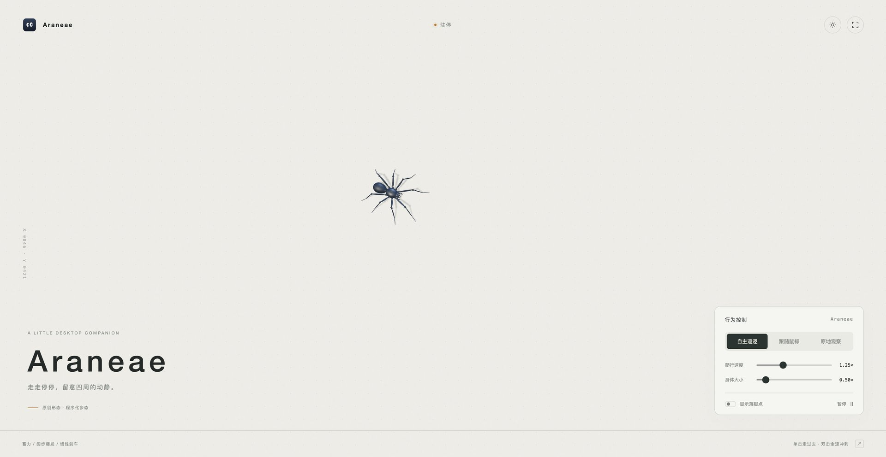
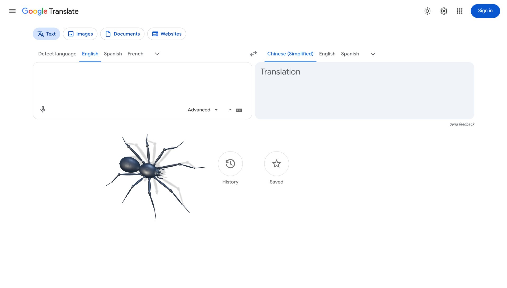

# Araneae

English | [简体中文](README.zh-CN.md)

> **Upstream Source**: Forked from [jaaasonho/Araneae](https://github.com/jaaasonho/Araneae) (MIT License).
> This repository ([Renven/Araneae](https://github.com/Renven/Araneae)) builds on the upstream project with full **Windows 10/11 desktop companion support**, **automatic zero-power suspension on display-off / lock / Modern Standby**, **pointer avoidance**, **launch-at-startup**, **spider color presets**, and **Windows rendering optimizations**.

A procedural 3D spider desktop companion that walks, observes, dodges, and dashes across your screen. Built with **Tauri 2 + Three.js**, its body, eight legs, eyes, and fine hairs are generated purely in code—no external 3D models or runtime network access required.

**[Try the upstream browser demo](https://jaaasonho.github.io/Araneae/)** — runs directly in your browser tab without installation.





---

## Upstream & Fork Enhancements

This repository preserves compatibility with the upstream macOS app and standalone browser version while adding the following enhancements on `main`:

- **Full Windows Desktop Support (`x64`)**: Verified on Windows 10 (22H2+) and Windows 11 with transparent click-through overlay (`WS_EX_NOACTIVATE | WS_EX_TOOLWINDOW`), multi-monitor routing, mixed-DPI seam alignment, system tray integration, and multi-size `icon.ico`.
- **Automatic Power / Session Suspension (Windows)**:
  - Monitors display state (`GUID_SESSION_DISPLAY_STATUS`), session lock/unlock (`WTSRegisterSessionNotification` + startup `WTSSessionInfoEx` detection), and sleep / Modern Standby (`RegisterSuspendResumeNotification`) via a hidden top-level Win32 message window.
  - Automatically suspends rendering, timers, and mouse-hook processing across both the floating **pet** window and the **Browser Version (`original`)** window, dropping suspended CPU usage by >99% and GPU utilization to `0%` without altering the user's manual Pause or Hide settings.
  - Uses monotonic power epochs to discard stale cross-suspend frames, async layout/cursor responses, and queued mouse input, resuming smoothly on wake/unlock.
- **Zero-Polling Pointer Avoidance (Windows)**: Optional **Avoid Pointer** mode (outside Follow mode) checks cursor proximity directly in the low-level mouse hook so the spider darts away when your pointer gets close.
- **Windows Launch at Startup**: Toggle in the control panel that persists or removes the current-user login entry under `HKCU\Software\Microsoft\Windows\CurrentVersion\Run`.
- **Custom Colors & 10 Spider Presets**: Pick any custom `#RRGGBB` tint or switch between 10 famous spider presets (*Black Widow, Redknee, Peacock, Wandering, Funnel-Web, Wolf, Golden Orb, Goliath, Huntsman, Crab*) with English and Simplified Chinese UI labels.
- **Windows Rendering & Power Diagnostics**: Adaptive frame pacing (24–60 FPS), tight 512×512 spider-tracking shadow map, and a process-group CPU/GPU measurement script (`scripts/measure-windows-power.ps1`).

---

## Core Features

- **Procedural 3D Spider & Physics**: Articulated eight-legged grounded gait, head/body observation gestures, momentum-based braking, skid marks, and dust particles.
- **Three Behavior Modes**: Autonomous patrol (*Patrol*), follow the cursor (*Follow Pointer*), or inspect in place (*Observe*).
- **Multi-Display Transparent Overlay**: Click-through by default, supporting horizontal, vertical, and staggered monitor arrangements, plus an option to confine movement to the current display.
- **Appearance & Controls**: Adjustable speed (`0.35×–3.00×`, default `1.25×`), size (`0.35×–2.10×`, default `0.50×`), color/presets, pause, hide, and automatic Simplified Chinese / English UI following the system language.
- **Offline & Self-Contained**: Three.js r170 is bundled locally; zero telemetry, accounts, or network requests at runtime.

---

## Using the Desktop Companion

On launch, the spider appears on your desktop with a small eyes icon in the **system tray (Windows)** or **menu bar (macOS)**. The control panel stays closed until opened from the tray/menu bar.

| Action | Effect |
| --- | --- |
| Tray / menu bar or Control Panel → Mode | Switch between Patrol, Follow Pointer, and Observe |
| Windows `Ctrl + click` / macOS `⌘ Command + click` | Dash to the clicked point at up to `3×` speed; click again to redirect |
| Toggle **Avoid Pointer** *(Windows)* | Make the spider dodge when your cursor approaches (outside Follow mode) |
| Toggle **Allow Cross-Display Movement** | Restrict or allow roaming, following, and dashing across monitors |
| Color Picker / Presets | Apply a custom hex tint or one of 10 spider presets (with one-click reset) |
| **Pause** / **Hide** (or `Space` in Control Panel) | Stop continuous rendering and ignore movement commands |
| Toggle **Launch at Startup** *(Windows)* | Add or remove current-user login autostart in `HKCU\...\Run` |

- Regular clicks and double-clicks pass straight through to underlying apps.
- Manual dashes preserve your active mode; changing modes cancels an active dash.
- Runtime settings (mode, speed, size, color, pause, hide) stay in memory and reset on relaunch; only Windows **Launch at Startup** is persisted in the user registry.

### Multi-Display, Power & Known Limitations

- **Displays**: Monitors must share an edge for crossing; mirrored displays are treated as one region. Hot-plugging or rearranging displays updates coordinates automatically and recovers the spider onto a visible screen if its display is disconnected.
- **Power & Lock Screen (Windows)**: Display-off (`Off`), session lock, and sleep / Modern Standby pause rendering automatically (`Dimmed` keeps running). On lock/unlock or wake, manual Pause and Hide states are preserved intact.
- **Overlays & Permissions**: Coverage is not guaranteed over lock screens, UAC prompts, exclusive fullscreen games, or other later topmost windows. Due to Windows UIPI, standard-privilege builds cannot receive `Ctrl + click` over elevated (Administrator) windows.
- **Signing**: Local builds are unsigned (no Authenticode signature or Apple notarization) and include no automatic updater.

### Mouse Events & Privacy

The desktop companion uses passive global mouse monitoring (`WH_MOUSE_LL` on Windows; `NSEvent` global monitor on macOS) strictly for `Ctrl + click` / `Command + click` dash detection and optional local cursor-proximity checks for **Avoid Pointer** on Windows. It never swallows mouse events, never logs keystrokes or cursor trajectories, and contains no telemetry or network upload code.

---

## Running & Building from Source

### Windows Desktop Companion (`x64`)

Requires **Node.js 18+**, **Visual Studio C++ Build Tools** (MSVC + Windows 10/11 SDK), **Rust 1.88+** (`x86_64-pc-windows-msvc`), **WebView2 Runtime** (preinstalled on Windows 11), and **Tauri CLI 2**:

```powershell
cargo install tauri-cli --version '^2' --locked
npm run desktop:dev
```

Build the Release executable or NSIS installer:

```powershell
# Standalone Release executable -> src-tauri/target/release/shadow-spider-desktop.exe
cargo build --release --manifest-path src-tauri/Cargo.toml --locked

# NSIS Installer -> src-tauri/target/release/bundle/nsis/
npm run desktop:build:win
```

### macOS Desktop Companion

Requires **Node.js 18+**, **Rust**, **Xcode Command Line Tools**, and **Tauri CLI 2** (verified on Apple Silicon):

```bash
xcode-select --install
cargo install tauri-cli --version '^2' --locked
npm run desktop:dev
npm run desktop:build
```

App bundle output: `src-tauri/target/release/bundle/macos/Araneae.app`.

### Standalone Browser Version

Requires **Node.js 18+** (no `npm install` needed):

```bash
npm run dev
```

Open **http://127.0.0.1:4173/** (do not open `dist/index.html` directly because ES Modules require HTTP). Browser controls: **click to move, double-click to dash, `Space` to pause**.

---

## Project Structure & Verification

| Path | Responsibility |
| --- | --- |
| `dist/app.js` | 3D scene, simulation loop, and top-level Tauri suspend bridge |
| `dist/organic.js` | Procedural anatomy, color/preset materials, hairs, and 2D fallback |
| `dist/motion.js`, `dist/gait.js`, `dist/leg-safety.js` | Kinematics, eight-legged gait, support constraints, and leg clearance |
| `dist/patrol.js`, `dist/skid-effects.js` | Autonomous patrol, observation gestures, and braking effects |
| `dist/desktop*.js` | Multi-display routing, viewport cropping, native frame clock, and suspend state sync |
| `dist/controls.html`, `dist/controls.js` | Desktop control panel UI |
| `src-tauri/src/main.rs` | Tauri app lifecycle, `FrameClock`, tray menu, and IPC commands |
| `src-tauri/src/power.rs` | Windows display / lock / Modern Standby monitor and `SuspendState` state machine |
| `src-tauri/src/interaction.rs` | Global passive mouse hook, click gesture, pointer avoidance, and epoch filtering |
| `src-tauri/src/desktop.rs`, `autostart.rs`, `settings.rs`, `language.rs` | Native display geometry, Windows autostart, validated settings, and locale detection |
| `scripts/` | Simulation checks, desktop unit tests, and `measure-windows-power.ps1` |

### Checks & Tests

```powershell
# JavaScript syntax check
npm run check

# Rust formatting, compile check & unit tests (29 tests)
cargo fmt --manifest-path src-tauri/Cargo.toml -- --check
cargo check --manifest-path src-tauri/Cargo.toml --locked
cargo test --manifest-path src-tauri/Cargo.toml --locked

# Desktop Node unit tests (32 tests: routing, clock, suspend, viewport, i18n, colors)
node --test scripts/check-desktop-routing.mjs scripts/check-desktop-clock.mjs scripts/check-desktop-suspend.mjs scripts/check-desktop-viewport.mjs scripts/check-desktop-i18n.mjs scripts/check-desktop-color.mjs

# Windows process-group CPU & GPU power sampling (replace <PID> with running shadow-spider-desktop PID)
powershell -ExecutionPolicy Bypass -File scripts/measure-windows-power.ps1 -ProcessId <PID> -Seconds 30
```

> **Windows CI**: `.github/workflows/windows.yml` runs JS syntax checks, `cargo fmt --check`, all 6 desktop Node test suites, `cargo check --locked`, and `cargo test --locked` on `windows-latest`. Note that `scripts/check-desktop-motion.mjs` is retained in `npm run desktop:test` but currently fails on the unchanged upstream baseline at `manual-horizontal-slow: patrol took over a manual destination`.

---

## License & Third-Party Notices

- **Upstream & License**: Released under the [MIT License](LICENSE), originally created by [jaaasonho](https://github.com/jaaasonho) ([jaaasonho/Araneae](https://github.com/jaaasonho/Araneae)).
- **Three.js r170**: Bundled under `dist/assets/`, copyright Three.js authors, MIT License (see [THREE-LICENSE.txt](dist/assets/THREE-LICENSE.txt)).
- **Rust Dependencies**: Pinned in `src-tauri/Cargo.lock` and remain under their respective licenses.
