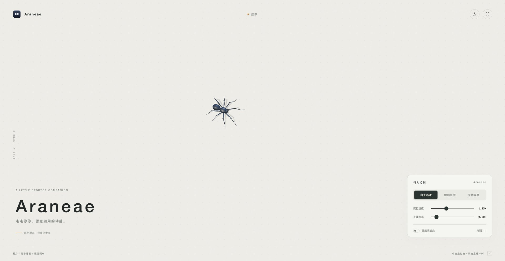
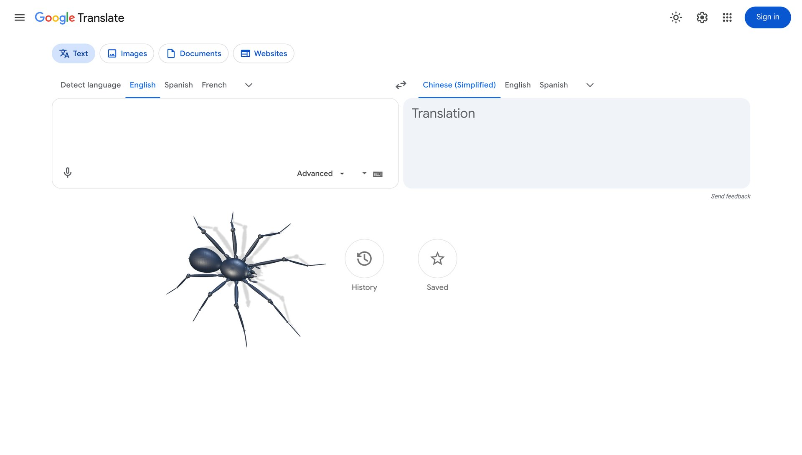

# Araneae

[English](README.md) | 简体中文

> **上游来源**：本项目 Fork 自 [jaaasonho/Araneae](https://github.com/jaaasonho/Araneae)（MIT 许可证）。
> 本仓库（[Renven/Araneae](https://github.com/Renven/Araneae)）在上游源码基础上重点完善了 **Windows 10/11 桌面端支持**、**息屏 / 锁屏 / 休眠自动零功耗挂起**、**零轮询鼠标避让**、**Windows 开机自启动**、**自定义配色与 10 款蜘蛛预设** 以及 **Windows 渲染性能优化**。

一个在屏幕上散步、观察、躲避和冲刺的程序化 3D 蜘蛛桌宠。基于 **Tauri 2 + Three.js** 构建，身体、八条腿、眼睛和细毛全部由代码实时生成，无需外部 3D 模型，运行全程无需联网。

**[在线体验上游网页版演示](https://jaaasonho.github.io/Araneae/)** — 无需安装，直接在浏览器标签页体验。





---

## 上游来源与本仓库增强

在完整保留上游 macOS 桌宠与独立网页版能力的前提下，本仓库 `main` 分支新增了以下改进：

- **完整的 Windows 桌面端支持（x64）**：已在 Windows 10（22H2+）与 Windows 11 双屏环境下实机验证，支持透明鼠标穿透悬浮（`WS_EX_NOACTIVATE | WS_EX_TOOLWINDOW`）、多屏跨屏路由、混合 DPI 接缝对齐、Windows 系统托盘图标与多尺寸 `icon.ico`。
- **Windows 息屏 / 锁屏 / Modern Standby 自动挂起（零功耗优化）**：
  - 通过独立的隐藏顶层 Win32 消息窗口，同时监听显示器开关（`GUID_SESSION_DISPLAY_STATUS`）、会话锁屏/解锁（`WTSRegisterSessionNotification` + 启动期 `WTSSessionInfoEx` 锁屏初值探测）与睡眠/新型待机（`RegisterSuspendResumeNotification`）。
  - 同时挂起**桌宠窗口（`pet`）**与从控制面板打开的**完整原版窗口（`original`）**：真机实测挂起期间整个进程组（主进程 + 全部 WebView2 子进程）CPU 消耗降幅 **>99%**、GPU 利用率峰值 **`0%`**，且绝不篡改用户手动设置的「暂停 / 隐藏」状态。
  - 前后端统一采用单调递增的电源代次（`epoch`），严格过滤跨挂起迟到帧、过时布局/光标异步结果以及锁屏前残留的鼠标输入，亮屏解锁后平滑无缝续跑。
- **零轮询鼠标避让（Windows）**：在非「跟随鼠标」模式下可开启「躲避鼠标」，由低级鼠标钩子在本地比对光标与蜘蛛距离触发避让，无额外轮询开销。
- **Windows 开机自启动开关**：在控制面板一键开关，读写当前用户注册表 `HKCU\Software\Microsoft\Windows\CurrentVersion\Run`。
- **自定义配色与 10 款著名蜘蛛预设**：支持任意 `#RRGGBB` 自定义取色，内置 10 种蜘蛛预设（黑寡妇、红膝、孔雀跳蛛、游走蛛、漏斗网蛛、狼蛛、黄金圆蛛、歌利亚捕鸟蛛、巨蟹蛛、蟹蛛），支持中英文界面跟随系统语言。
- **Windows 渲染优化与功耗采样工具**：支持自适应帧率调节（24–60 FPS）、512×512 紧凑跟踪阴影贴图，并提供进程组 CPU/GPU 采样脚本 `scripts/measure-windows-power.ps1`。

---

## 核心特性

- **程序化外形与步态**：八足抓地步态、头身观望姿态、惯性刹车、滑痕与浮尘效果。
- **三种行为模式**：自主巡逻、跟随鼠标、原地观察。
- **多屏透明悬浮**：默认鼠标穿透，支持左右、上下及错位相接的多显示器排列，也可关闭跨屏将其限定在当前屏幕。
- **外观与控制**：可调速度（`0.35×–3.00×`，默认 `1.25×`）、体型（`0.35×–2.10×`，默认 `0.50×`）、配色与预设、暂停/隐藏；界面语言自动跟随系统（简体中文 / 英文）。
- **纯本地离线运行**：Three.js r170 随源码附带，无遥测、无账号登录、无数据上传。

---

## 使用指南

启动后桌宠直接显示在屏幕上，同时在 **Windows 系统托盘** / **macOS 菜单栏**出现小眼睛图标，点击即可切换模式或打开「控制面板」。

| 操作 | 效果 |
| --- | --- |
| 托盘 / 菜单栏或控制面板选择模式 | 切换「自主巡逻」「跟随鼠标」「原地观察」 |
| Windows `Ctrl + 单击` / macOS `⌘ Command + 单击` | 以最高 `3×` 速度冲刺前往目标点；再次点击可改换目的地 |
| 开关「躲避鼠标」*（Windows）* | 非跟随模式下，光标靠近蜘蛛时自动避让 |
| 开关「允许跨屏」 | 开启或禁止跨显示器巡逻、跟随与冲刺 |
| 颜色选择 / 预设 | 应用自定义十六进制配色或 10 款蜘蛛预设（支持一键重置） |
| **暂停** / **隐藏**（或在控制面板按空格） | 停止持续渲染并忽略移动指令 |
| 开关「开机启动」*（Windows）* | 写入或移除当前用户 `HKCU\...\Run` 自启动项 |

- 普通单击、双击会直接穿透给下层应用，不会干扰日常操作。
- 手动冲刺不会改变当前所选模式；途中切换模式则会取消冲刺路线。
- 除 Windows「开机启动」写入当前用户注册表外，其余运行参数仅保存在内存中，退出后不持久化。

### 多屏、电源行为与已知限制

- **多屏显示**：跨屏要求显示器边缘相接，镜像屏幕视作同一区域；显示器热插拔或排列调整后会自动更新坐标，当前屏幕移除时自动把蜘蛛恢复到可见屏幕。
- **息屏 / 锁屏 / 待机（Windows）**：显示器关闭（`Off`）、锁屏或进入睡眠 / Modern Standby 时自动挂起渲染（屏幕变暗 `Dimmed` 仍继续运行）；恢复亮屏且解锁后自动续跑，并完整保留用户的手动暂停与隐藏状态。
- **覆盖与权限限制**：锁屏、UAC 提权界面、独占全屏游戏或后置顶的 `Topmost` 窗口可能覆盖桌宠；受 Windows UIPI 限制，普通权限运行无法接收管理员权限窗口上的 `Ctrl + 单击`。
- **代码签名**：本地构建默认无 Windows Authenticode 签名与 Apple 公证，也无自动更新器。

### 鼠标事件与隐私

桌宠仅通过系统被动全局鼠标监听（Windows `WH_MOUSE_LL` / macOS `NSEvent`）识别 `Ctrl + 单击` / `Command + 单击` 冲刺，以及在 Windows 开启「躲避鼠标」时于本地比对光标与蜘蛛距离。应用不吞掉鼠标事件，不记录键盘输入或鼠标轨迹，不包含任何遥测或网络上传代码。

---

## 从源码运行与构建

### Windows 桌宠（x64）

环境要求：**Node.js 18+**、**Visual Studio C++ Build Tools**（MSVC + Windows 10/11 SDK）、**Rust 1.88+**（`x86_64-pc-windows-msvc`）、**WebView2 Runtime**（Windows 11 默认自带）与 **Tauri CLI 2**：

```powershell
cargo install tauri-cli --version '^2' --locked
npm run desktop:dev
```

构建 Release 可执行文件或 NSIS 安装包：

```powershell
# 独立 Release 可执行文件 -> src-tauri/target/release/shadow-spider-desktop.exe
cargo build --release --manifest-path src-tauri/Cargo.toml --locked

# NSIS 安装包 -> src-tauri/target/release/bundle/nsis/
npm run desktop:build:win
```

### macOS 桌宠

环境要求：**Node.js 18+**、**Rust**、**Xcode Command Line Tools** 与 **Tauri CLI 2**（Apple Silicon 已验证）：

```bash
xcode-select --install
cargo install tauri-cli --version '^2' --locked
npm run desktop:dev
npm run desktop:build
```

产物路径：`src-tauri/target/release/bundle/macos/Araneae.app`。

### 独立网页版

仅需 **Node.js 18+**（无需 `npm install`）：

```bash
npm run dev
```

浏览器打开 **http://127.0.0.1:4173/**（不要直接双击 `dist/index.html`，ES Module 需经 HTTP 服务加载）。网页版操作为：**单击前往、双击冲刺、空格暂停**。

---

## 项目结构与验证

| 路径 | 职责 |
| --- | --- |
| `dist/app.js` | 3D 场景、动画循环与顶层 Tauri 窗口挂起桥接 |
| `dist/organic.js` | 程序化外观、配色/预设材质、细毛与 2D 兼容绘制 |
| `dist/motion.js`、`dist/gait.js`、`dist/leg-safety.js` | 运动学、八足步态、支撑约束与腿段避让 |
| `dist/patrol.js`、`dist/skid-effects.js` | 自主巡逻、观望动作与刹车滑痕/浮尘效果 |
| `dist/desktop*.js` | 多屏坐标导航、视口裁剪、原生帧时钟与跨代挂起同步 |
| `dist/controls.html`、`dist/controls.js` | 桌宠控制面板 |
| `src-tauri/src/main.rs` | Tauri 生命周期、`FrameClock`、系统托盘与 IPC 命令 |
| `src-tauri/src/power.rs` | Windows 显示器 / 锁屏 / Modern Standby 监听与 `SuspendState` 状态机 |
| `src-tauri/src/interaction.rs` | 全局被动鼠标钩子、冲刺手势、鼠标避让与代次过滤 |
| `src-tauri/src/desktop.rs`、`autostart.rs`、`settings.rs`、`language.rs` | 原生多屏几何、Windows 自启动、设置校验与语言检测 |
| `scripts/` | 运动模拟检查、桌面单元测试与 `measure-windows-power.ps1` |

### 常用检查命令

```powershell
# JavaScript 语法检查
npm run check

# Rust 格式检查、编译检查与单元测试（29 项）
cargo fmt --manifest-path src-tauri/Cargo.toml -- --check
cargo check --manifest-path src-tauri/Cargo.toml --locked
cargo test --manifest-path src-tauri/Cargo.toml --locked

# 桌面端 Node 单元测试（32 项：导航、时钟、电源挂起、裁剪、多语言、配色预设）
node --test scripts/check-desktop-routing.mjs scripts/check-desktop-clock.mjs scripts/check-desktop-suspend.mjs scripts/check-desktop-viewport.mjs scripts/check-desktop-i18n.mjs scripts/check-desktop-color.mjs

# Windows 进程组 CPU 与 GPU 功耗采样（将 <PID> 替换为正在运行的 shadow-spider-desktop 进程 ID）
powershell -ExecutionPolicy Bypass -File scripts/measure-windows-power.ps1 -ProcessId <PID> -Seconds 30
```

> **Windows CI 说明**：`.github/workflows/windows.yml` 在 `windows-latest` 上自动执行 JS 语法检查、`cargo fmt --check`、全部 6 个桌面 Node 专项测试以及 `cargo check` / `cargo test --locked`。完整桌面运动模拟 `scripts/check-desktop-motion.mjs` 仍保留在 `npm run desktop:test` 中，但上游基线存在既有的 `manual-horizontal-slow: patrol took over a manual destination` 失败，暂未纳入 CI 门禁。

---

## 许可证与第三方代码

- **上游项目与许可证**：基于 MIT 许可证发布（见 [LICENSE](LICENSE)），原作者与版权署名为 [jaaasonho](https://github.com/jaaasonho)（上游仓库：[jaaasonho/Araneae](https://github.com/jaaasonho/Araneae)）。
- **Three.js r170**：随源码附带于 `dist/assets/`，由 Three.js 作者持有版权并采用 MIT 许可，完整声明见 [THREE-LICENSE.txt](dist/assets/THREE-LICENSE.txt)。
- **Rust 依赖**：版本固定于 `src-tauri/Cargo.lock`，各自保留其原许可证。
